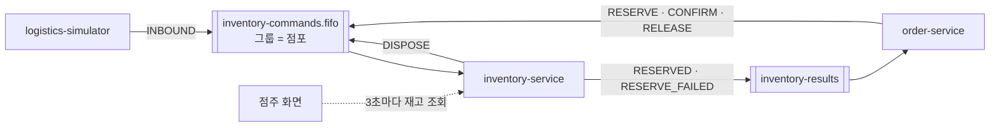

# inventory-service

> FreshLink의 **재고 심장부**. 상품과 유통기한별 재고(lot)를 관리하고, 입고·예약·확정·해제·폐기를 처리하며, 점주 화면이 3초마다 조회하는 재고 API를 제공한다.

| 항목 | 내용 |
| --- | --- |
| 담당 | 이태우 |
| 관련 기능 ID | S-10, S-11, S-13, S-15, S-20, S-30, S-31, S-32, U-10, E-01, E-09 |
| 기술 | Java 21, Spring Boot 4.0.x, Spring Data JPA, Spring Cloud AWS 4.x (SQS), ShedLock, MySQL |
| 관측성 | Actuator·Micrometer → Prometheus (앱 포트의 `/actuator/prometheus`, 관리 포트를 따로 두지 않는다. 모든 서비스가 8080) · Micrometer Tracing → Zipkin · JSON 로그(traceId 포함) → Alloy → Loki ([gitops/platform/observability](https://github.com/sesac-freshlink/gitops/tree/main/platform/observability)) |
| DB | RDS `freshlink-mysql`의 `inventory` 스키마 (DB 사용자 `inventory_app`) |
| 배포 | GitHub Actions → ECR `freshlink/inventory-service` → ArgoCD → EKS (파드 2개) |

---

## 1. FreshLink는 무엇인가

편의점 점주와 고객이 **같은 재고 데이터**를 보는 서비스다. 핵심 약속은 두 가지다.

1. 고객이 결제하면 점주 화면의 재고가 **정확하게** 줄어든다. 동시에 여러 명이 사도 재고가 음수가 되지 않는다.
2. **유통기한이 지난 상품은 고객에게 팔리지 않는다.**

이 두 약속을 실제로 지키는 곳이 이 서비스다.

## 2. 가장 중요한 규칙

**재고를 바꾸는 일은 전부 `inventory-commands.fifo` 큐를 거친다.** 입고, 예약, 확정, 해제, 폐기 모두 쪽지(메시지)로 들어와서, **점포별로 한 줄로 서서** 처리된다(메시지 그룹 = storeId). 그래서 DB 락 없이도 같은 점포 재고가 꼬이지 않는다.



## 3. 먼저 알아둘 용어

| 용어 | 뜻 |
| --- | --- |
| lot | 유통기한이 같은 묶음. '컵라면, 10월 20일까지, 20개'가 lot 하나 |
| FEFO | 유통기한이 빨리 끝나는 lot부터 판다 |
| 예약 | 결제 전에 재고를 잠깐 잡아 두는 것. 결제 성공 시 확정, 실패 시 해제 |
| 원장(ledger) | 재고가 왜 바뀌었는지 남기는 기록장 (입고 +20, 판매 −1, 폐기 −2) |
| 멱등 처리 | 같은 쪽지가 두 번 와도 한 번만 반영 ([common](https://github.com/sesac-freshlink/common) 모듈 사용) |

**구매 가능 수량 = 유통기한이 지나지 않은 lot들의 (수량 − 예약 수량) 합계**

## 4. 기능과 API

| ID | 기능 | API / 방식 | 완료 기준 |
| --- | --- | --- | --- |
| S-10 | 재고 목록 | `GET /owner/inventory` | 상품별 총 수량·예약 수량·구매 가능 수량 |
| S-11 | lot별 재고 | `GET /owner/inventory/{productId}/lots` | 유통기한별 수량 |
| S-13 | 변동 이력 | `GET /owner/inventory/ledger` | 이력 합계가 현재 재고와 같다 |
| S-15 | 실시간 반영 | `GET /owner/inventory` (점주 화면이 3초마다 조회) | 결제·입고·폐기 후 3초 안에 새로고침 없이 갱신 |
| S-20 | 입고 처리 | INBOUND 쪽지 | 같은 shipmentId는 두 번 반영되지 않는다 |
| S-30 | 임박 목록 | `GET /owner/inventory/expiring` | 24시간 이내·경과 lot 구분 |
| S-31 | 기한 경과 판매 차단 | 내부 로직 | 경과 lot은 구매 가능 수량·예약에서 제외 |
| S-32 | 폐기 | `POST /owner/disposals` | lot 수량 감소 + 원장 '폐기' |
| U-10 | 점포 상품 목록 | `GET /stores/{storeId}/products` | 0개면 '품절' |
| E-01 | 점포별 순서 처리 | FIFO 큐 소비 | 동시 예약 100건에도 재고가 음수가 되지 않는다 |
| E-09 | 유통기한 스케줄러 | 스케줄러 (ShedLock) | 주기마다 임박·경과 상태 갱신 |

점주 API는 점포 ID를 주소로 받지 않고 항상 gateway가 붙여 준 `X-Store-Id` 헤더를 쓴다.

## 5. 데이터 모델

| 표 | 주요 컬럼 |
| --- | --- |
| `product` | id, product_code, name, category, price |
| `inventory_lot` | id, store_id, product_id, expiry_date, quantity, reserved_quantity |
| `reservation` | id, order_id, lot_id, quantity, status(RESERVED/CONFIRMED/RELEASED) |
| `ledger` | id, store_id, lot_id, type(INBOUND/SALE/DISPOSE), quantity, ref_id, created_at |
| `inbound` | id, shipment_id(유니크), store_id, received_at |
| `outbox`, `processed_message` | common 모듈이 쓰는 표 |

## 6. 운영에서 챙길 것

- **스케줄러 중복 실행:** 파드가 2개라 ShedLock으로 한 파드만 돌게 한다.

## 7. 폴더 구조

```
inventory-service/
├── src/main/java/com/freshlink/inventory/
│   ├── config/       # SQS, ShedLock, Swagger 설정
│   ├── product/      # 상품, 고객용 점포 상품 목록
│   ├── inventory/    # lot, 예약, 원장, 재고 조회
│   ├── inbound/      # INBOUND 처리
│   ├── disposal/     # 폐기
│   ├── messaging/    # 큐 리스너, 결과 쪽지 발행
│   └── scheduler/    # 유통기한 스케줄러
├── src/main/resources/application.yml
└── src/test/java/com/freshlink/inventory/
```

## 8. dev 환경에서 실행하기

> 아직 뼈대만 있는 상태다. 첫 작업으로 [Spring Initializr](https://start.spring.io)에서 Gradle·Java 21·Web·JPA·MySQL Driver로 프로젝트를 만들고, Spring Cloud AWS SQS와 `com.freshlink:common` 의존성을 추가한다.

개발할 때도 AWS dev 환경의 RDS·SQS·Cognito를 그대로 쓴다. AWS 로그인, DB 포트 포워딩(SSM), 개인 큐 설정은 [개발 환경 접속 가이드](https://github.com/sesac-freshlink/.github/blob/main/docs/개발환경-접속.md)를 따른다.

```bash
export SPRING_PROFILES_ACTIVE=dev
export DB_URL=jdbc:mysql://127.0.0.1:3306/inventory   # SSM 포트 포워딩으로 연결한 dev RDS
export DB_PASSWORD=<dev Secrets Manager의 inventory_app 비밀번호>
export QUEUE_PREFIX=dev-<내 이름>-                     # 개인 큐
./gradlew bootRun
```

logistics-simulator로 입고 쪽지를 보내고 `GET /owner/inventory/ledger`에서 '입고'가 찍히는지 확인한다.

## 9. 브랜치와 기여

- `main`(배포) ← `dev`(통합, 기본 브랜치) ← `feat/<기능ID>-<설명>` (예: `feat/S-32-disposal`)
- 커밋·PR 제목: `feat(S-32): 폐기 API 추가`
- 쪽지 형식이 바뀌는 PR은 `message-spec` 라벨을 달고 합치기 전에 김경우에게 꼭 알린다.

자세한 규칙은 [.github 레포](https://github.com/sesac-freshlink/.github)를 참고한다.
