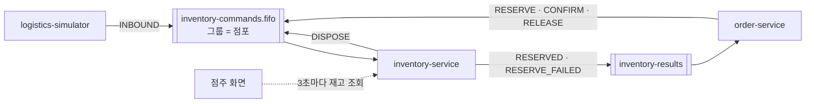

# inventory-service

> FreshLink의 **재고 심장부**. 상품과 유통기한별 재고(lot)를 관리하고, 입고·예약·확정·해제·폐기를 처리하며, 점주 화면이 3초마다 조회하는 재고 API를 제공한다.

| 항목 | 내용 |
| --- | --- |
| 담당 | 이태우 |
| 관련 기능 ID | S-10, S-11, S-13, S-15, S-20, S-30, S-31, S-32, U-10, E-01, E-09 |
| 기술 | Java 21, Spring Boot 4.0.x, Spring Data JPA, Flyway(테이블 마이그레이션), Spring Cloud AWS 4.x (SQS), ShedLock, MySQL |
| 관측성 | Actuator·Micrometer → Prometheus (앱 포트의 `/actuator/prometheus`, 관리 포트를 따로 두지 않는다. 모든 서비스가 8080) · Micrometer Tracing → Zipkin · JSON 로그(traceId 포함) → Alloy → Loki ([gitops/platform/observability](https://github.com/sesac-freshlink/gitops/tree/main/platform/observability)) |
| DB | RDS `freshlink-mysql`의 `inventory` 스키마 (DB 사용자 `inventory_app`) |
| 배포 | GitHub Actions → ECR `freshlink/inventory-service` → ArgoCD → EKS (파드 2개) |

---

## 1. FreshLink는 무엇인가

편의점 점주와 고객이 **같은 재고 데이터**를 보는 서비스다. 핵심 약속은 두 가지다.

1. 고객이 결제하면 점주 화면의 재고가 **정확하게** 줄어든다. 동시에 여러 명이 사도 재고가 음수가 되지 않는다.
2. **유통기한이 지난 상품은 고객에게 팔리지 않는다.**

이 두 약속을 실제로 지키는 곳이 이 서비스다.

## 2. 가장 중요한 규칙

**재고를 바꾸는 일은 전부 `inventory-commands.fifo` 큐를 거친다.** 입고, 예약, 확정, 해제, 폐기 모두 쪽지(메시지)로 들어와서, **점포별로 한 줄로 서서** 처리된다(메시지 그룹 = storeId). 그래서 DB 락 없이도 같은 점포 재고가 꼬이지 않는다.

**예외는 수동 조정(S-14) 하나다.** 점주가 실사로 수량을 바로 고치므로 쪽지 줄에 서지 않는다. 그래서 같은 lot을 고치는 쪽지 처리와 겹칠 수 있고, `inventory_lot.version`(낙관적 락)으로 겹침을 찾는다. 조정이 늦으면 409 `LOT_CHANGED`, 쪽지 처리가 늦으면 그 트랜잭션이 통째로 되돌려지고 SQS가 다시 보낸다. 쪽지 형식(common)을 바꾸지 않으려고 이렇게 했다.



## 3. 먼저 알아둘 용어

| 용어 | 뜻 |
| --- | --- |
| lot | 유통기한이 같은 묶음. '컵라면, 10월 20일까지, 20개'가 lot 하나 |
| FEFO | 유통기한이 빨리 끝나는 lot부터 판다 |
| 예약 | 결제 전에 재고를 잠깐 잡아 두는 것. 결제 성공 시 확정, 실패 시 해제 |
| 원장(ledger) | 재고가 왜 바뀌었는지 남기는 기록장 (입고 +20, 판매 −1, 폐기 −2) |
| 멱등 처리 | 같은 쪽지가 두 번 와도 한 번만 반영 ([common](https://github.com/sesac-freshlink/common) 모듈 사용) |

**구매 가능 수량 = 유통기한이 지나지 않은 lot들의 (수량 − 예약 수량) 합계**

## 4. 기능과 API

| ID | 기능 | API / 방식 | 완료 기준 |
| --- | --- | --- | --- |
| S-10 | 재고 목록 | `GET /owner/inventory` | 상품별 총 수량·예약 수량·구매 가능 수량. `safetyStock`·`lowStock`(구매 가능 < 안전재고) |
| S-11 | lot별 재고 | `GET /owner/inventory/{productId}/lots` | 유통기한별 수량 |
| S-13 | 변동 이력 | `GET /owner/inventory/ledger` | 이력 합계가 현재 재고와 같다 |
| S-15 | 실시간 반영 | `GET /owner/inventory` (점주 화면이 3초마다 조회) | 결제·입고·폐기 후 3초 안에 새로고침 없이 갱신 |
| S-20 | 입고 처리 | INBOUND 쪽지 | 같은 shipmentId는 두 번 반영되지 않는다 |
| S-30 | 임박 목록 | `GET /owner/inventory/expiring` | 24시간 이내·경과 lot 구분 |
| S-31 | 기한 경과 판매 차단 | 내부 로직 | 경과 lot은 구매 가능 수량·예약에서 제외 |
| S-32 | 폐기 | `POST /owner/disposals` 본문 `{lotId, quantity}` → **202** `{disposalId, lotId, quantity}`. 헤더 `X-Store-Id`·`X-User-Id`. 오류: 404 `LOT_NOT_FOUND`, 403 `LOT_NOT_IN_STORE`, 409 `NOT_DISPOSABLE`(정상 lot), 400 `VALIDATION_ERROR`(수량 1 미만)·`INVALID_QUANTITY`(폐기 가능 수량 초과) | 202 뒤 DISPOSE 쪽지를 처리하면 lot 수량 감소 + 원장 '폐기'. 처리 때 수량이 모자라면 SKIPPED |
| S-33 | 폐기 요청 이력 | `GET /owner/disposals` (선택 쿼리 `status=REQUESTED\|DONE\|SKIPPED`, 최신순 최근 100건). 헤더 `X-Store-Id` | 202로 접수된 요청이 DONE(수량 감소)·SKIPPED(예약 때문에 재고 그대로)로 끝났는지 점주가 본다 |
| S-40 | 안전재고 설정 | `GET /owner/inventory/safety-stocks` (상품 전체), `PUT /owner/inventory/safety-stocks/{productId}` 본문 `{safetyStock}`(0~999). 오류: 400 `VALIDATION_ERROR`, 404 `PRODUCT_NOT_FOUND` | 정하지 않은 상품은 기본값 5. 0이면 부족으로 표시하지 않는다. 재고를 바꾸지 않아 쪽지를 거치지 않는다 |
| S-14 | 재고 수동 조정·실사 | `POST /owner/inventory/adjustments` 본문 `{lotId, delta, reason, memo?}` → **201** `{adjustmentId, lotId, delta, quantityBefore, quantityAfter}`. `delta` −999~999(0 제외), `reason` COUNT·DAMAGE·LOSS·OTHER. 헤더 `X-Store-Id`·`X-User-Id`. 오류: 404 `LOT_NOT_FOUND`, 403 `LOT_NOT_IN_STORE`, 400 `VALIDATION_ERROR`·`INVALID_QUANTITY`(0), 409 `BELOW_RESERVED`(예약 수량 아래로), 409 `LOT_CHANGED`(쪽지 처리와 겹침). `GET /owner/inventory/adjustments`는 최신순 최근 100건 | 쪽지를 거치지 않고 바로 lot 수량 변경 + 조정 기록 + 원장 ADJUST(±). 겹침은 낙관적 락으로 찾는다(2장) |
| S-42 | 판매·폐기 통계 | `GET /owner/inventory/stats` (선택 쿼리 `from`·`to` 한국 날짜, 둘 다 포함. `to`를 빼면 오늘, `from`을 빼면 `to`까지 7일). 오류: 400 `INVALID_DATE_RANGE` | 원장을 상품·종류별로 `GROUP BY`해 입고·판매·폐기 수량, 조정 합계(±), 폐기율(폐기 ÷ (판매 + 폐기))을 준다. 금액은 order 몫이라 수량만 |
| U-10 | 점포 상품 목록 | `GET /stores/{storeId}/products` | 상품 30개 전부. 입고가 없는 상품·점포도 `availableQuantity 0`, `soldOut true`로 나온다 |
| E-01 | 점포별 순서 처리 (구현됨) | FIFO 큐 소비. RESERVE(FEFO 예약 → RESERVED/RESERVE_FAILED), CONFIRM, RELEASE, DISPOSE, INBOUND | 동시 예약 100건에도 재고가 음수가 되지 않는다 |
| E-09 | 유통기한 스케줄러 (구현됨) | `app.expiry.cron`(기본 자정) + ShedLock `lotStatusJob` | 주기마다 임박·경과 상태 갱신 |

점주 API는 점포 ID를 주소로 받지 않고 항상 gateway가 붙여 준 `X-Store-Id` 헤더를 쓴다. `/owner/**`에 이 헤더가 없으면 403 `STORE_NOT_LINKED`다.

API 문서(Swagger UI)는 `/swagger-ui.html`, 원본은 `/v3/api-docs`다. gateway가 이 경로를 넘기지 않으므로 **PC에서 서비스를 직접 띄웠을 때만** 열린다.

## 5. 데이터 모델

| 표 | 주요 컬럼 |
| --- | --- |
| `product` | id, product_code, name, category, price |
| `inventory_lot` | id, store_id, product_id, expiry_date, quantity, reserved_quantity, version(낙관적 락) |
| `reservation` | id, order_id, lot_id, quantity, status(RESERVED/CONFIRMED/RELEASED) |
| `disposal` | id, store_id, lot_id, quantity, requested_by, status(REQUESTED/DONE/SKIPPED), created_at, processed_at |
| `ledger` | id, store_id, lot_id, type(INBOUND/SALE/DISPOSE/ADJUST), quantity, ref_id, created_at |
| `adjustment` | id, store_id, lot_id, delta, quantity_before, quantity_after, reason, memo, adjusted_by, created_at |
| `inbound` | id, shipment_id(유니크), store_id, received_at |
| `safety_stock` | id, store_id, product_id, quantity(0~999), created_at, updated_at. (store_id, product_id) 유니크 |
| `outbox`, `processed_message` | common 모듈이 쓰는 표 |
| `shedlock` | 스케줄러·Outbox 발행기 잠금 |

상태가 바뀌는 길:

- **reservation:** RESERVE로 `RESERVED` → CONFIRM이면 `CONFIRMED`(lot 실물·예약 감소, 원장 SALE) / RELEASE면 `RELEASED`(예약만 복원, 원장 없음). 확정·해제된 예약은 다시 바뀌지 않는다.
- **disposal:** `POST /owner/disposals`로 `REQUESTED` → DISPOSE 쪽지 처리 때 `DONE`(lot 수량 감소, 원장 DISPOSE) / 폐기 가능 수량이 모자라면 `SKIPPED`(재고 그대로). 결과는 `GET /owner/disposals`(S-33)로 본다.
- **ledger:** 실물이 바뀔 때만 한 줄 추가한다. 입고 `+n`(ref_id = shipmentId), 판매 `−n`(orderId), 폐기 `−n`(disposalId), 조정 `±n`(adjustmentId). lot별 합계 = `inventory_lot.quantity`.
- **inventory_lot.status:** 스케줄러가 갱신하는 표시용(NORMAL → IMMINENT → EXPIRED). 판단에는 이 값을 쓰지 않고 그때마다 `expiry_date`와 지금 시각으로 계산한다. 판매(구매 가능 수량·예약)는 `expiry_date > 지금`인 lot만, 폐기 요청은 계산한 상태가 임박(24시간 이내)·경과인 lot만 받는다(정상 lot은 409 `NOT_DISPOSABLE`).

테이블은 **Flyway 마이그레이션**으로 만든다. `src/main/resources/db/migration/V1__init.sql`부터 순서대로 두고, 앱이 뜰 때 Flyway가 아직 안 적용된 파일을 순서대로 실행한다. JPA `ddl-auto`로 테이블을 만들지 않는다. 한 번 적용된 파일은 고치지 않고 `V2__...`처럼 새 파일을 추가한다.

## 6. 운영에서 챙길 것

- **스케줄러 중복 실행:** 파드가 2개라 ShedLock으로 한 파드만 돌게 한다. dev는 `EXPIRY_CRON`이 없어 자정에만 돈다. 시연 때는 `EXPIRY_CRON=0 * * * * *`(1분)을 gitops values에 넣어 달라고 요청한다.
- **실패한 쪽지:** 3번 실패하면 DLQ로 간다. 확인·재전송 절차는 [docs/실패-시나리오-절차.md](docs/실패-시나리오-절차.md).
- **동시 예약 시험:** [docs/동시성-테스트-절차.md](docs/동시성-테스트-절차.md)와 `scripts/e01-*`.
- **왜 FIFO 그룹과 낙관적 락인가:** [docs/동시성-설계-FIFO와-낙관적-락.md](docs/동시성-설계-FIFO와-낙관적-락.md). 줄을 세우지 않으면 무엇이 깨지는지 `FifoExperimentTest`로 직접 본다.
- **dev에서 한 번에 확인할 것:** [docs/dev-확인-절차.md](docs/dev-확인-절차.md).
- **쪽지 처리 지표:** `/actuator/prometheus`에 아래 두 가지가 나온다. Grafana에서 보는 식은 [docs/동시성-테스트-절차.md](docs/동시성-테스트-절차.md) 5-1.

| 지표 | 태그 | 뜻 |
| --- | --- | --- |
| `inventory_command_seconds_count`·`_sum`·`_max`·`_bucket` | `type`(INBOUND·RESERVE·CONFIRM·RELEASE·DISPOSE·UNKNOWN), `result`(processed·duplicate·failed) | 쪽지 한 번 처리에 걸린 시간. `_count`가 건수다. duplicate는 같은 messageId를 다시 받아 건너뛴 것, failed는 예외로 되돌린 것(SQS가 다시 보내므로 시도마다 센다) |
| `inventory_outbox_unpublished` | 없음 | 아직 보내지 않은 결과 쪽지 수. 0 근처가 정상이고 계속 늘면 outbox 발행이 막힌 것 |

## 7. 폴더 구조

```
inventory-service/
├── build.gradle                       # Boot 4.0.8, Web·JPA·Validation·Actuator·Flyway·MySQL·Testcontainers + common
├── src/main/java/com/freshlink/inventory/
│   ├── InventoryServiceApplication.java
│   ├── common/                        # 도메인과 상관없는 공통 코드
│   │   ├── config/       # SQS, ShedLock, Swagger 설정
│   │   ├── error/        # InventoryErrorCode(enum), GlobalExceptionHandler
│   │   ├── messaging/    # 큐 리스너, 결과 쪽지 발행
│   │   └── metrics/      # 쪽지 처리·미발행 outbox 지표(Micrometer)
│   └── domain/                        # 도메인별 엔티티·서비스·API
│       ├── product/      # 상품, 고객용 점포 상품 목록
│       ├── inventory/    # lot, 예약, 원장, 재고 조회
│       ├── inbound/      # INBOUND 처리
│       ├── disposal/     # 폐기
│       ├── adjustment/   # 수동 조정·실사(S-14)
│       ├── safetystock/  # 안전재고 설정(S-40)
│       ├── stats/        # 판매·폐기 통계(S-42)
│       └── scheduler/    # 유통기한 스케줄러
├── src/main/resources/
│   ├── application.yml                # 공통. 값은 환경 변수
│   ├── application-dev.yml            # 로그 레벨만 다름
│   ├── application-prod.yml
│   └── db/migration/                  # Flyway SQL. V1__init.sql 부터
├── src/test/java/com/freshlink/inventory/
│   ├── InventoryServiceApplicationTests.java   # 애플리케이션이 뜨는지 (Testcontainers MySQL)
│   ├── TestcontainersConfiguration.java        # 테스트·로컬 실행용 MySQL 8.4 컨테이너
│   ├── TestInventoryServiceApplication.java    # IntelliJ에서 DB 없이 실행할 때 이걸 Run
│   ├── FixedClockConfiguration.java            # 지금 시각 고정(2026-10-25 12:00 KST). 쓰는 테스트끼리 컨테이너 하나를 같이 쓴다
│   ├── ReserveTest, ConfirmReleaseTest, DisposalTest, LotStatusTest, FailureScenarioTest, SafetyStockTest, InventoryStatsTest, AdjustmentTest, FifoExperimentTest  # 쪽지 처리·API·스케줄러
│   └── common/error/GlobalExceptionHandlerTest.java   # 오류 응답 모양 (DB 없이)
├── scripts/                           # 동시 예약 100건 투입(e01-reserve-100.ps1)·집계·정리 SQL
└── docs/                              # dev 확인·실패 시나리오·동시성 시험 절차
```

## 7-1. 오류 처리

규칙은 .github 레포 `docs/백엔드-공통-규칙.md` 6장. 응답 모양은 common 라이브러리, 오류 목록과 핸들러는 이 레포에 있다.

| 할 일 | 방법 |
| --- | --- |
| 업무 오류 던지기 | `throw new BusinessException(InventoryErrorCode.LOT_NOT_IN_STORE);` 한 줄 |
| 오류 코드 추가 | `common/error/InventoryErrorCode`에 `XXX(404, "메시지")` 한 줄. 핸들러는 안 건드린다 |
| 응답 모양 | 항상 `{"code": "LOT_NOT_IN_STORE", "message": "다른 점포의 lot입니다", "traceId": "4bf92f3577b34da6"}`. `@Valid` 실패는 400 `VALIDATION_ERROR`(message에 필드별 사유), 없는 경로는 404 `NOT_FOUND`, 그 밖은 500 `INTERNAL_ERROR`(원인은 로그에만) |

## 8. dev 환경에서 실행하기

> **DB 없이 IntelliJ에서 띄우기:** Docker Desktop을 켜고 `src/test/.../TestInventoryServiceApplication`을 Run 하면 Testcontainers가 MySQL 8.4 컨테이너를 띄워 연결한다. 환경 변수가 필요 없고, 끄면 컨테이너도 사라진다. 아래는 dev RDS에 붙일 때다.

개발할 때도 AWS dev 환경의 RDS·SQS·Cognito를 그대로 쓴다. AWS 로그인, DB 포트 포워딩(SSM), 개인 큐 설정은 [개발 환경 접속 가이드](https://github.com/sesac-freshlink/.github/blob/main/docs/개발환경-접속.md)를 따른다.

```bash
export SPRING_PROFILES_ACTIVE=dev
export DB_URL=jdbc:mysql://127.0.0.1:3306/inventory   # SSM 포트 포워딩으로 연결한 dev RDS
export DB_PASSWORD=<dev Secrets Manager의 inventory_app 비밀번호>
export QUEUE_PREFIX=dev-<내 이름>-                     # 개인 큐
./gradlew bootRun
```

logistics-simulator로 입고 쪽지를 보내고 `GET /owner/inventory/ledger`에서 '입고'가 찍히는지 확인한다.

### 8-1. 환경 변수

값과 비밀은 여기 적지 않는다. dev 클러스터 값은 gitops `envs/dev/inventory-service/values.yaml`, DB 비밀번호는 Secrets Manager에 있다.

| 변수 | 쓰는 곳 | 없으면 |
| --- | --- | --- |
| `SPRING_PROFILES_ACTIVE` | 프로필 `dev`·`prod`(로그 레벨만 다르다) | 기본 프로필 |
| `DB_URL` | MySQL 주소(`jdbc:mysql://…/inventory`) | 비어 있음. PC에서는 `TestInventoryServiceApplication`이 Testcontainers로 대신 붙는다 |
| `DB_USERNAME` | DB 사용자 | `inventory_app` |
| `DB_PASSWORD` | DB 비밀번호(비밀값) | 비어 있음 |
| `QUEUE_PREFIX` | 큐 이름 앞부분. `app.queue.commands` = `<접두사>inventory-commands.fifo`, `app.queue.results` = `<접두사>inventory-results`. PC는 개인 큐(`dev-<이름>-`) | `dev-` |
| `EXPIRY_CRON` | 유통기한 스케줄러 주기(`app.expiry.cron`, Spring cron 6자리, Asia/Seoul) | `0 0 0 * * *`(자정) |
| `AWS_REGION` | SQS 리전 | `ap-northeast-2` |
| `GITHUB_ACTOR`, `GITHUB_TOKEN` | **의존성을 받을 때.** 빌드와 `./gradlew bootRun`이 common 라이브러리를 GitHub Packages에서 받는다(`read:packages`). Gradle 캐시에 이미 있으면 실행 때는 쓰지 않는다 | 의존성 해석 실패(빌드·실행이 시작되지 않음) |

PC에서 실행 구성을 만들 때는 위 값에 `AWS_PROFILE=freshlink-dev`를 더한다(접속 가이드 3장). 추적(Zipkin)과 JSON 로그는 클러스터에서 차트가 `MANAGEMENT_TRACING_EXPORT_ZIPKIN_*`, `LOGGING_STRUCTURED_FORMAT_CONSOLE`로 켠다.

## 9. 브랜치와 기여

- `main`(배포) ← `dev`(통합, 기본 브랜치) ← `feat/<기능ID>-<설명>` (예: `feat/S-32-disposal`)
- 커밋·PR 제목: `feat(S-32): 폐기 API 추가`
- 쪽지 형식이 바뀌는 PR은 `message-spec` 라벨을 달고 합치기 전에 김경우에게 꼭 알린다.

자세한 규칙은 [.github 레포](https://github.com/sesac-freshlink/.github)를 참고한다.
